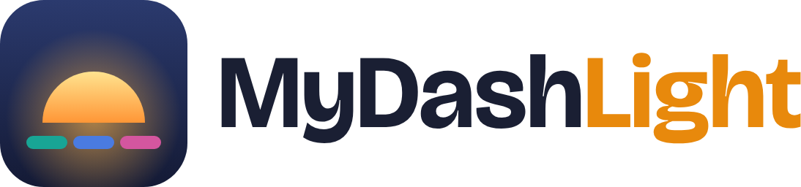
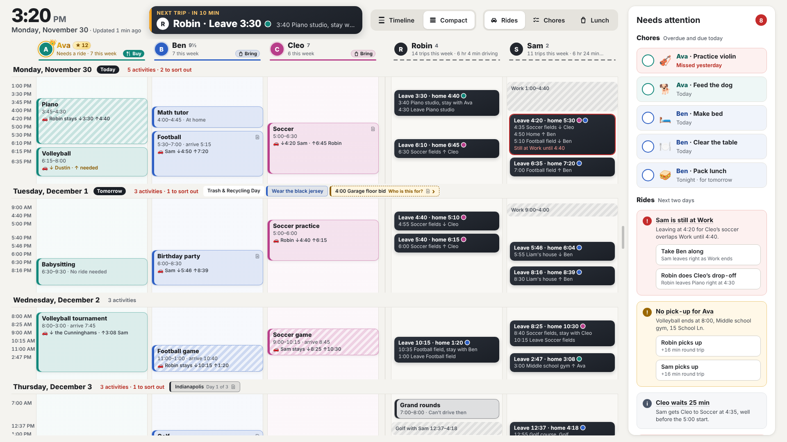
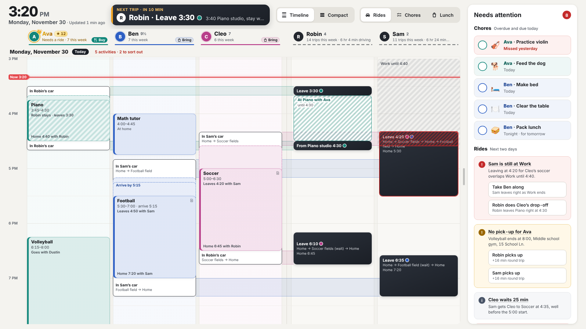
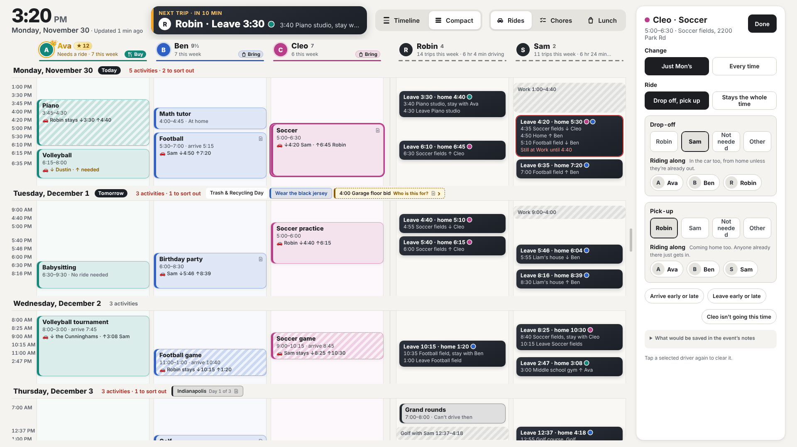
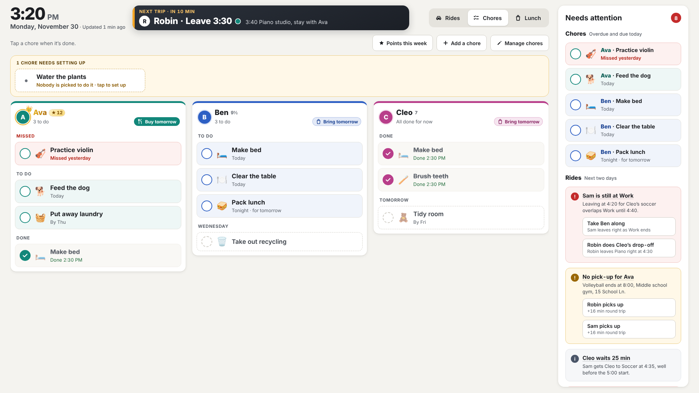
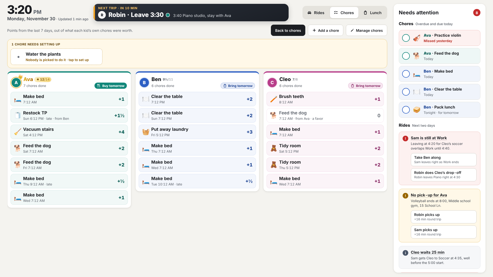
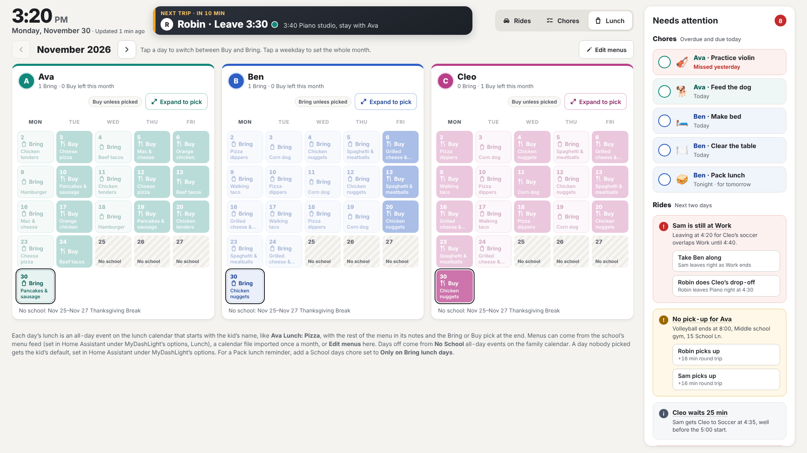
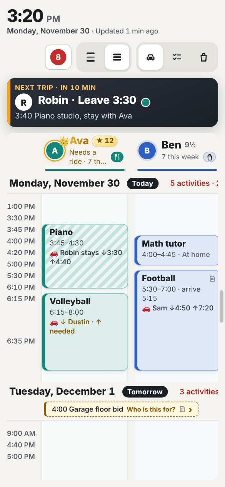
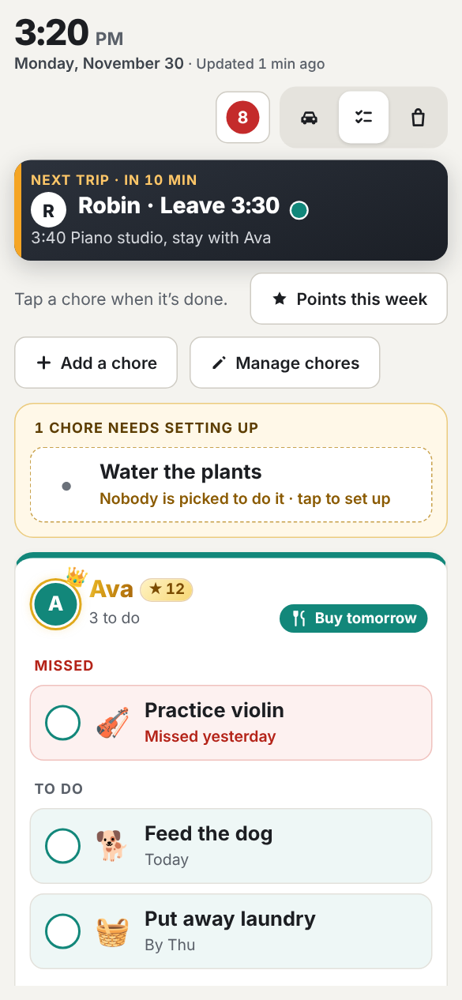

<h1>
  <picture>
    <source media="(prefers-color-scheme: dark)" srcset="https://raw.githubusercontent.com/mobrien118/MyDashLight/main/custom_components/mydashlight/brand/dark_logo@2x.png" />
    
  </picture>
</h1>

**A kitchen touchscreen for a busy family.** MyDashLight plans who drives whom where, keeps the
kids' chores and points, and tracks school lunches, all from the Google Calendar your family already
uses. It shows only what needs attention now, so a glance on the way out the door is enough.

It runs inside [Home Assistant](https://www.home-assistant.io). Your family's data stays in your
own Google Calendar and Google Tasks: there's no account to make, no subscription and no extra
server.

Screenshots use a made-up family: parents Robin and Sam, kids Ava, Ben and Cleo.

## What it does

### Plans the rides

Add "Ava Piano" with an address to the family calendar and MyDashLight works out the rest: who's
free to drive, when to leave with real traffic times, who can share a car, and what clashes. Every
problem comes with one-tap fixes ("Robin does Cleo's drop-off"). Changes are saved in the event's
notes in Google Calendar, so they show on everyone's phone too.

Tap any activity to change who drops off and picks up, whether the driver stays, who rides along,
and when the kid needs to be there.

It also handles parents' own appointments and errands, hotel stays, carpools, kids who aren't
going this time, and events that run over several days.

### Keeps the chores

Chores repeat daily, weekly, monthly or on school days, for one kid or taking turns. Kids check
them off on the screen, and on-time chores earn points. **Points this week** shows who's ahead.

### Sorts out lunches

The Lunch tab shows each kid's school menu like the printed one. Tap a day to switch between Buy
and Bring. Menus can fill in by themselves from the school's menu feed, and each kid's column
says what to pack tonight.

### Reminds people on their phones

Before each drive, the driver gets a reminder with the stops, and each kid in the car gets one
saying when they leave. If nobody is driving a ride later today, both parents hear about it. The
whole board works on phones too, through the Home Assistant app.

  
  

## Setting it up

The [setup guide](docs/setup.md) goes from nothing to a working kitchen screen:

1. [Get the calendars ready](docs/setup.md#1-get-the-calendars-ready): one shared family calendar,
   with each title starting with who it's for.
2. [Set up Google sign-in](docs/setup.md#2-set-up-google-sign-in) in your own Google Cloud project.
3. [Install MyDashLight](docs/setup.md#3-install-mydashlight-in-home-assistant) from the
   Marketplace (HACS) as a custom repository.
4. [Add the integration](docs/setup.md#4-add-the-integration) and pick your calendars.
5. [Adjust the settings](docs/setup.md#5-adjust-the-settings): reminders, drive times, chore
   points.
6. [Set up the kitchen screen](docs/setup.md#6-set-up-the-kitchen-screen): any browser, or a
   Raspberry Pi with the script in [`kiosk/`](kiosk/README.md).

## Guides

| Guide | What's in it |
| --- | --- |
| [Setup](docs/setup.md) | Installing and configuring, step by step, and what to do when something's wrong |
| [The family calendar](docs/calendar.md) | How to title events, ride details in event notes, stays, errands and drive times |
| [The kitchen app](docs/kitchen-app.md) | The rides board, changing rides, pairing a screen and screen settings |
| [Chores and points](docs/chores.md) | Chore templates in Google Tasks, checking off, and how points are counted |
| [Lunch](docs/lunch.md) | The lunch calendar, school menu feeds and Buy or Bring picks |
| [Reminders](docs/reminders.md) | Phone reminders, Google Calendar reminders and "is the driver on their way" |
| [Raspberry Pi kitchen screen](kiosk/README.md) | Turning a Pi and any screen into the kitchen display |
| [Development](docs/development.md) | How it's built, the actions and live data, tests, and rendering these screenshots |

## License

MIT. See [LICENSE](LICENSE).
