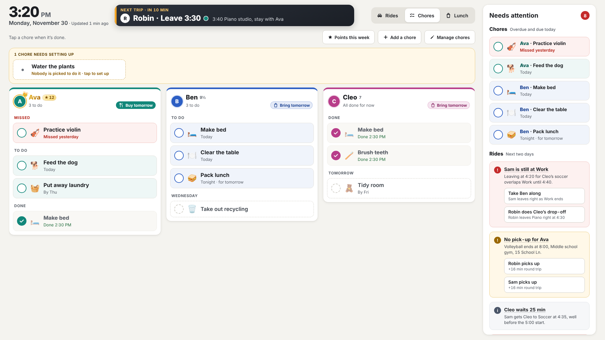
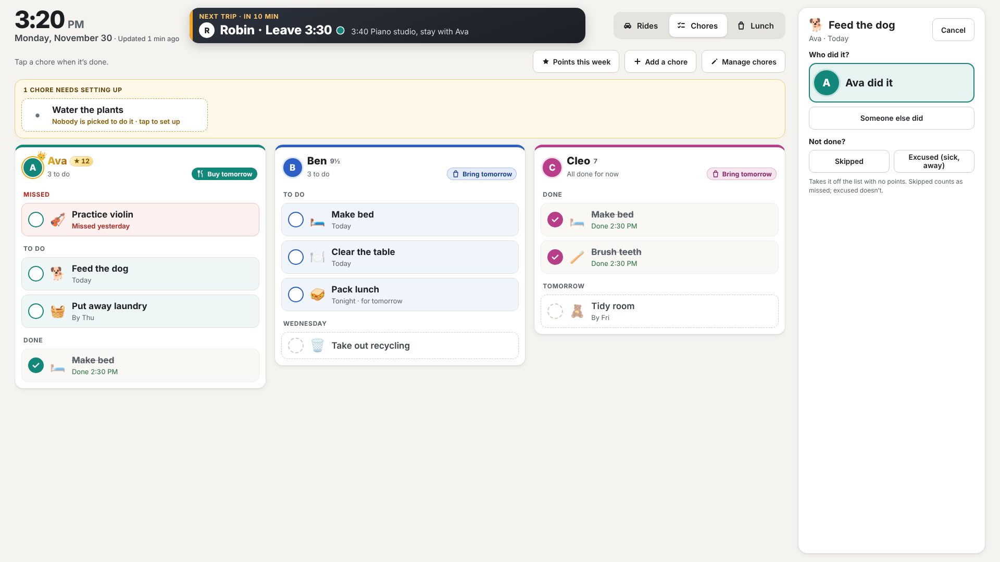
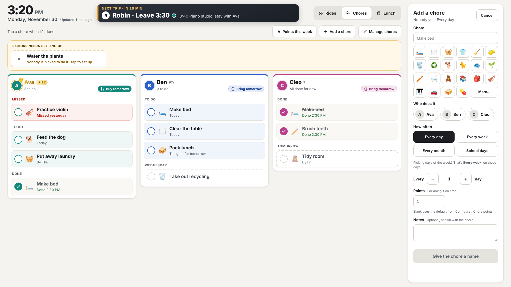
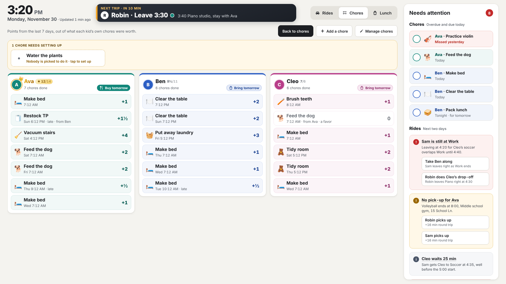

# Chores and points



Chores live in Google Tasks, under the Google account MyDashLight signs in with. MyDashLight makes
these lists the first time it runs:

- **Chore seeds**, the one list every chore grows from. Each task on it is a chore's seed (its
  template): its title is the chore, and its notes say who, how often and the rest. A School days
  chore comes only on the kid's school days (see [Lunch](lunch.md)).
- **Chores: \<kid\>**, one per kid. These are the real chores, each due on its day.
  MyDashLight fills them from the seeds, 7 days ahead (**Configure > Names and planner timing
  > Chore days ahead**). Tasks added to a kid's list by hand are one-off chores: they show, and
  can be checked off, but MyDashLight leaves them alone.

A seed's notes end in a Chore block, which the `save_chore_template` action writes:

```
Bins at the curb by 7 PM.

--- Chore ---
Id: 3f9a1c22b7
Repeats: Every 2 weeks
Who: Ava, Ben
Take turns: yes
Days: Thu
Starts: 2026-11-04
Ends: 2027-06-05
Points: 1
```

| Line | Meaning |
| --- | --- |
| Repeats | How often, one of four kinds, each counted in its own unit: `Every day` (or `Every 3 days`), `Every week` (or `Every 2 weeks`), `Every month` (or `Every 3 months`, `Quarterly`), or `School days`. Left out, Days decides: weekdays make it weekly, dates monthly, none daily. |
| Who | The kids who do it, by name, or Everyone. Each gets their own, unless they take turns. |
| Take turns | The kids in Who take turns, one each time, in order from Starts. |
| Days | Weekly: weekdays such as `Mon, Thu` or `Mon-Fri`, or `Any` for sometime that week (shows from Monday, due Sunday). Monthly: a date such as `15` or `last`, a day such as `1st Sat`, or `Any` for sometime that month. School days: which weekdays (none for every school day). Daily chores have no Days: picking days makes a chore weekly, so "every 2 days, on Mondays" can't happen. Several are separated by commas. |
| Starts, Ends | The first and last days. Starts is the day the template was made if left out. |
| Points | What the chore earns when it's done on time (see **Points** below). Left out, it's worth the default from **Configure > Chore points**. `0` for a chore that shouldn't count, such as packing a lunch the kid chose to bring. |
| When | School days only: `Night before` shows it from the evening before each school day (Sunday for Monday); the board shows it from 1 PM that day. It's still due on the school day, so doing it that morning is on time. Left out, it shows that morning. |
| Only | School days only: `Bring lunch days` makes it only on days the kid brings lunch, for chores like packing it. |

Text above the block is the chore's details, shown when it's tapped. A leading emoji in the title
is its icon. Checking a seed off in Google pauses it. A seed typed into Google by hand works too;
MyDashLight adds its Id, Repeats and Starts lines the first time it reads it. One it can't read (an
unknown kid, say) makes no chores, and `get_chores` lists what's wrong with it.

Each chore on a kid's list has the template's title and details, and a Chore block with `From`
(the template's Id) and `For` (the day it was made for). From then on:

- **Checked off** on the board, on a phone or in the Google Tasks app: Google records when. Done
  after its due day counts as late. Checked off through MyDashLight, it also records who did it
  with a `Done by: <name>` line: the kid it's for, or anyone else picked, parents included.
  Opening it again takes that line out.
- **Skipped or excused:** closed without being done, with `Closed: skipped` (it wasn't done and
  counts as a miss) or `Closed: excused` (sick, away, or not needed that day). Neither earns
  points, and nobody can earn them for it afterwards. Opening it again takes the line out.
- **Still open after its due day:** MyDashLight adds `Missed: <day>` to its notes, once for each
  day it missed. When the next one of that chore shows (or its template is paused), the missed one
  is checked off with `Closed: missed`, so the board shows one, not a pile, and the miss stays
  counted.
- **Template changed:** chores coming up that aren't done yet follow it (new title, day or kid).
  Done chores and chores whose day has passed never change, so the history stays true.

**Points.** Nothing about points is written on the chores. MyDashLight works them out each time
from who checked a chore off and when, its seed's Points as they are now, and the settings, so
changing a chore's points or a setting counts for check-offs already made too. A chore whose seed
is gone counts at the default. Lines older versions wrote (`Points`, `Earned`) are taken out.

| Done | Earns |
| --- | --- |
| On time, by the kid it's for | All its points |
| Late (after its due day), by anyone, the kid it's for included | The late share, 50% unless set otherwise |
| By someone else before it's late | Nothing: it's a favor |
| Skipped or excused | Nothing |
| Missed (closed out) | Nothing. Points are never taken away. |

**Configure > Chore points** sets the default points, the late share and how long after a chore
turns late before someone else earns points for it. From then until it's done, the chore says
**up for grabs** under its name (each chore's `open_to_others` time). Keep the late share under 100%, or two kids
would earn more by swapping their chores than by doing their own. `get_chores` returns each
chore's `worth` and `earned`, and under `points`, everyone's `scores` for the last 7 days (kids
and parents, by id), the `leaders` (the kids with the most, or none while everyone has 0), and the
`log`: each check-off counted, newest first, with who did it, who it was for, when, its points and
whether it was late, and `possible`: what each kid's own chores due in those 7 days (today included)
were worth on time, excused ones left out. The board's **Points this week** button shows the log,
with each score as `12½/15` beside the name.

The actions: `mydashlight.get_chores` returns the chores the board shows (each kid's open and
overdue chores, those coming up, and those done today) and the templates;
`mydashlight.set_chore_done` checks one off (with `by` for someone other than the kid it's for,
and `skip: skipped` or `skip: excused` when it wasn't done) or opens it again; `mydashlight.save_chore_template`
adds or changes a template; `mydashlight.remove_chore_template` removes one. The app subscribes
to `{"type": "mydashlight/chores/subscribe"}` for the same chores as they change.

## Chores on the board



Tap **Chores** at the top of the kitchen app for a column per kid, in the kids' colors:

- **Missed**: overdue chores, with how many times they've been missed.
- **To do**: today's chores, and this week's or month's that are showing ("By Sun").
- **Done**: checked off today, or ahead of their day, with when.
- Then the days ahead, each under the day it shows, faded until then.

Tap a chore to check it off: the panel asks who did it, with the kid it's for as the big button
and **Someone else did** for anyone else, parents included (saved as `Done by` in its notes). Tap a
done chore to undo it. Each change is saved to Google Tasks straight away and shows on every board
(the kitchen screen, a PC, a phone) at once. A change made in the Google Tasks app instead shows
within a minute, when MyDashLight next reads the lists.



**Add a chore** and **Manage chores**, above the columns, open the chore editor in the panel, like a
ride's: its name and picture, who does it (each one, or taking turns), how often (some days of the
week, weekly or monthly), which days, how many weeks or months apart, and notes. A chore can be
paused or removed there too. A task typed straight into the Chore seeds list in Google Tasks
shows at the top of the Chores board under **needs setting up**; tap it to pick who does it and
when.
The **Needs attention** list starts with a Chores section: every kid's overdue chores and the ones
due today, with the kid's name, and they can be checked off right there. A chore done sometime this
week or month joins that list only on its last day, so the list stays short. With no chores yet,
the Chores board says how to add the first one.


