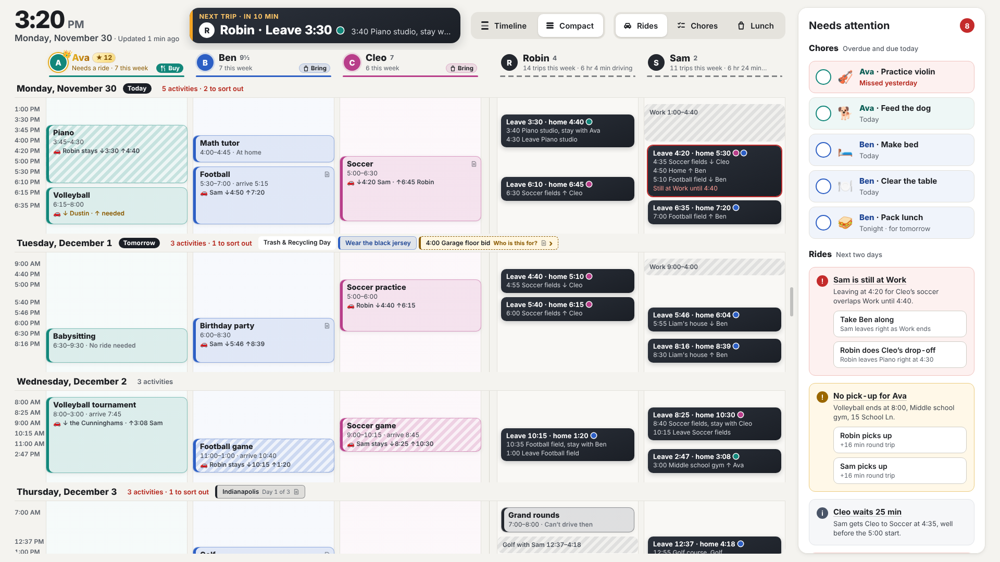
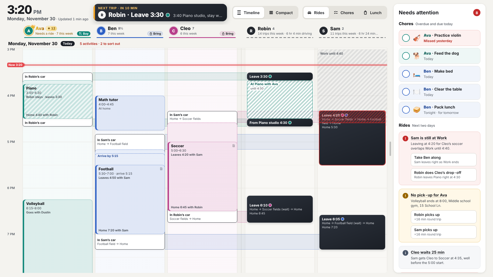
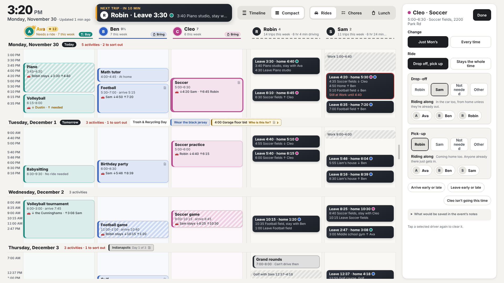
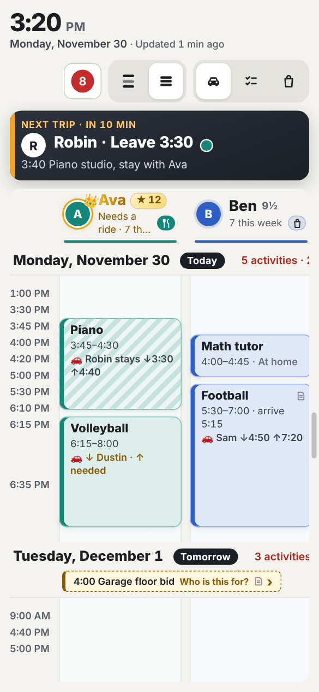
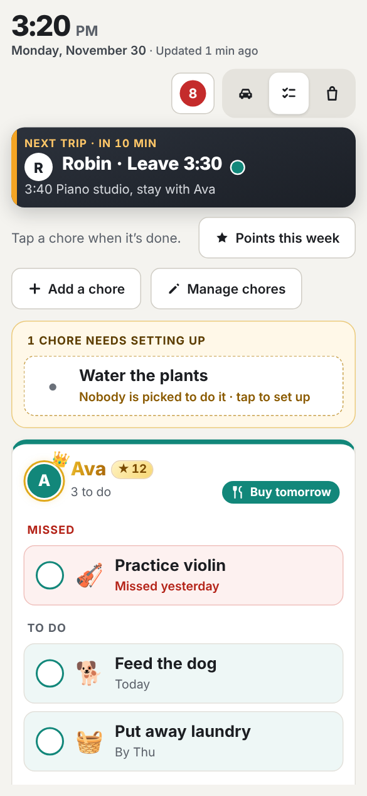
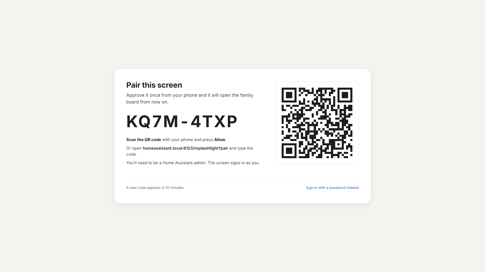

# The kitchen app

The kitchen app's first screen is everyone's week of rides: a column for each kid, then one for
each parent. A kid's column holds their activities and their time in a car; a parent's column
holds their trips out of the house, with dots for who's in the car, and their busy times. A tinted band links a kid's car time to whoever is driving.

Along the top are the clock, the next trip (who leaves when, and where to), and each person's
heading: a kid's points this week and today's Buy or Bring lunch, a parent's trips and driving time
for the week. The board has two views, switched at the top:

- **Compact**, the default, drops the time scale: everything sits in start order, with each trip's
  stops listed. Nothing is cut off: long titles wrap onto a second line, and each card and trip is
  just as tall as what's on it. To save room, a note that isn't about a ride goes on the end of the
  time line ("6:30–9:30 · No ride needed"), and trip stops use the cards' arrows: "Soccer fields
  ↓ Cleo" for a drop-off, "↑ Cleo" for a pick-up, "Home ↑ Ben" to collect someone at home.
- **Timeline** spaces everything by the clock, so overlaps and tight handoffs are easy to see.

A **Rides | Chores | Lunch** switch at the top flips between this board, the [chores board](chores.md#chores-on-the-board) and the [Lunch tab](lunch.md).

## Moving through the week

What's over drops off, so more of the week fits on screen. An activity stays until it has ended
and the drive home is done; a trip, a car ride or a busy time goes once it ends. In Timeline, today
starts just before now, and anything already under way runs in from the top with an open (dashed)
top edge. Today's heading counts what's left ("2 activities left", or "All done for today"), days
before today go altogether, and all-day events stay until their day is over. Nothing that's over
asks for attention any more. Add `?past=show` to the address to keep everything on the board.

There's no row of day buttons taking up the top of the screen: the board is one long scroll
through the week, with each day's heading pinned at the top as you go. Swipe (or drag, or use the
mouse wheel) to move through the days. While the board is moving, the week's days slide out at its
right edge, each with dots for what's on and a red count for what needs sorting out; tap one to go
straight there. They tuck away a moment later, leaving a small tab beside the board to pull them
out again. Tapping a day's date also goes to that day and brings out the others. Once you've moved
off today (or, in Timeline, well away from now), a **Today** button appears at the bottom to jump
back. Add `?daypicker=off` to the address to leave out the days at the edge.

## Needs attention and changing a ride

The **Needs attention** list shows chores that are overdue or due today, then ride problems in the next 48 hours (no driver, late, a kid
waiting, a parent still at work, a kid double-booked) with the suggested fixes, plus heads-ups
for today and tomorrow. Problems later in the week show in red on their day's heading ("1 to sort
out") and as a red count on that day at the board's edge. Tap any activity, car or trip to change who drives each way, whether the driver
stays, who's taken along, and the arrive-by time. A repeating activity asks whether to change just
that day or every time. If a kid is skipping one, tap **Not attending**: it stays on the board,
crossed out, with no rides planned, and it no longer counts as a clash. When a kid is
double-booked, each event's name in the Needs attention card opens that event, so the one being
skipped is a tap away. Each change is saved in the event's notes on Google straight away.

Anything with notes people wrote in Google Calendar (an activity, a parent's own event, an
all-day event or an event for nobody) has a small note mark. Rest the mouse on it, or hold a
finger on it for half a second, to read the notes in a bubble. Only what people wrote shows, not
the `--- Rides ---` or `--- Lunch ---` block (or loose ride lines) MyDashLight keeps there. Lifting
the finger after a hold doesn't open the event, so a quick tap still opens it as always. A tap
anywhere, scrolling or Escape puts the bubble away; tabbing to it with the keyboard shows it too.

## Where to open it

Both are signed in to Home Assistant:

- **Rides** in Home Assistant's sidebar. This works in the Home Assistant app on a phone too, laid out
  for the small screen.
- `<your Home Assistant URL>/mydashlight-kitchen`, a full-screen page for the kitchen screen. After
  three minutes without a touch it closes anything open and scrolls back to now. To set up a
  Raspberry Pi as the kitchen screen, see [kiosk/README.md](../kiosk/README.md).

  
  

## Pairing the kitchen screen

A kitchen screen has no keyboard, so instead of a password it pairs:

1. The kitchen page shows a code, like `KQ7M-4TXP`, and a QR code.
2. On your phone, scan the QR code (or open `<your Home Assistant URL>/mydashlight?pair` and type
   the code), check the code matches, and press **Allow**. You need to be a Home Assistant admin.
3. The screen is signed in to Home Assistant as you, and opens the board.

Home Assistant keeps the screen signed in as long as it's used, and drops the sign-in after 90 days
unused. To sign the screen out, open your Home Assistant profile, go to **Security**, and delete
the refresh token for `<your Home Assistant URL>/mydashlight-kitchen`; the screen shows a new code.
Only the screen that showed the code can collect the sign-in, so seeing the code isn't enough. A
browser already signed in to Home Assistant at the same address skips pairing, and the pairing page
also offers **Sign in with a password instead**.

## On-screen keyboard and pointer

The kitchen page brings its own keyboard: it slides up when a text box is clicked or tapped, the
same with a mouse or a touchscreen. For a screen with a real keyboard, add `?keyboard=off` to the
address.

The mouse pointer hides after 3 seconds without movement and comes back when the mouse moves.
Add `?cursor=show` to keep it on screen.

## Screen settings

Either address can pick how it opens, so each screen can have its own:

| Add to the address | Does |
| --- | --- |
| `?view=compact` | Opens rides in Compact view |
| `?view=timeline` (or `?view=full`) | Opens rides in Timeline view |
| `?page=chores` | Opens on the chores board instead of rides |
| `?page=lunch` | Opens on the Lunch tab instead of rides |
| `?past=show` | Keeps activities and trips that are over on the board, for checking what happened |
| `?daypicker=off` | Leaves out the week's days that slide out at the board's edge while scrolling |
| `?keyboard=off` | Hides the on-screen keyboard, for a screen with a real keyboard |
| `?cursor=show` | Keeps the mouse pointer on screen |

Combine them with `&`, for example `<your Home Assistant URL>/mydashlight-kitchen?page=chores&view=compact`.
You can still switch by tapping; the kitchen screen goes back to its page and view after three
minutes without a touch. Without a `view`, the board opens in whichever view was last picked in that
browser, or Compact if none was; without a `page`, it opens on rides.

The app is built from `frontend/` into `custom_components/mydashlight/frontend`, so a HACS update
brings it along.
