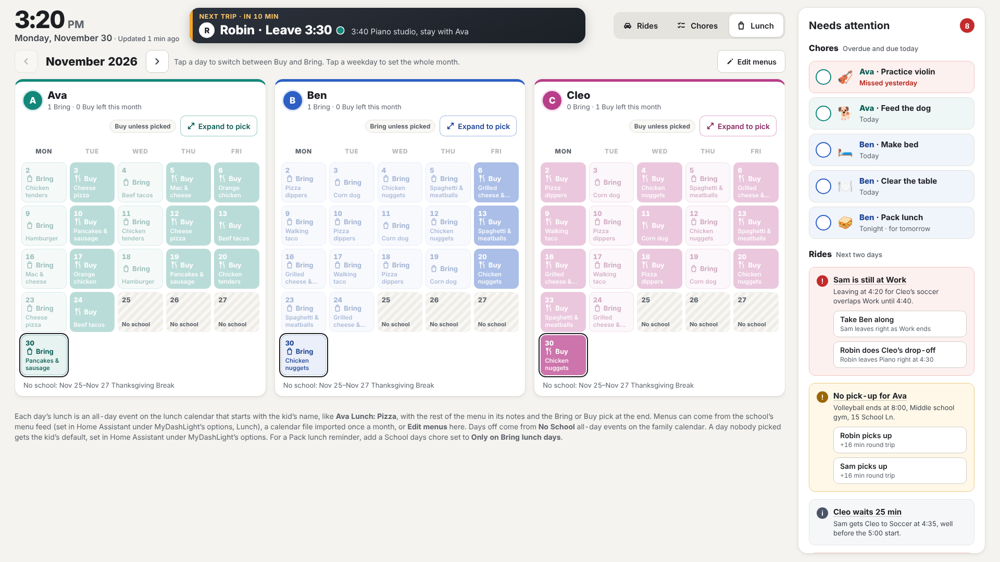

# Lunch



Lunches live on a calendar of their own, so they stay out of the family calendar. Make one in
Google Calendar (such as "MyDashLight Lunches"; it doesn't need sharing with anyone) and pick it
under **Configure > Calendars**. There's nothing to keep in Home Assistant:

- An all-day event on the family calendar with **No School** in its title (such as "No School –
  Thanksgiving Break") means no school those days: for the kids it names, or for every kid when it
  names nobody. Every other weekday is a school day.
- Each day's lunch is one all-day event on the lunch calendar, starting with the kid's name.
  Titled **Ava Lunch: Pizza, side salad**, it says what Ava's school serves that day, and its notes
  can hold the rest of the menu (other choices, sides). Titled just **Ava Lunch**, the dish is the
  first line of its notes, or the menu isn't known yet. Each kid has their own, so kids at
  different schools get different menus.
- The kid's pick goes in a short block at the end of that event's notes:

  ```
  --- Lunch ---
  Pick: Bring
  ```

  A school day with no pick gets the kid's default: Buy, unless the kid is picked under
  **Configure > Lunch** as bringing by default. A pick on a day with no menu yet goes on a plain
  **Lunch** event, which the menu fills in later.
- A month of menus can be imported into the lunch calendar from a `.ics` file (Google Calendar:
  **Settings > Import & export**), or added on the Lunch tab.
- **Menu feeds.** Many schools publish their menu as a calendar to subscribe to (look for an
  ICAL or Subscribe button on the menu page). Paste its address for each kid under **Configure >
  Lunch**. Every 6 hours MyDashLight reads it and adds each day's lunch from today on to the lunch
  calendar as an `Ava Lunch: …` event (or fills in that day's plain **Lunch** event, keeping the
  pick): the first item is the dish, the rest goes in the notes.
  Breakfast (`B: …`) and `No School` entries are skipped. These events carry a private mark, so
  only they follow later changes to the feed; a menu typed by hand, imported, or changed on the
  Lunch tab is left alone.

Tap **Lunch** at the top of the kitchen app for this month and next, a card per kid with Monday to
Friday like the printed menu. Tap a day to switch it between Buy and Bring, or tap a weekday's name
to make every one left that month Bring (or Buy, when they all are already). Each tap adds, changes or removes the kid's event that day on
the lunch calendar. Days off are drawn hatched with their name underneath. Each day shows its menu; tap
**Edit menus** to add or change one, for one kid or several at once. Each kid's column on
the rides and chores boards shows a small Buy or Bring chip: today's until 1 PM, then the next
school day's, so in the evening it says what to pack.

The School days chores list uses the same school days: a chore there is made only on a kid's
school days, and its turns count school days, so a day off doesn't change whose turn it is. When
the calendars can't be read, School days chores are left as they are until they can.

The actions: `mydashlight.get_lunches` returns each kid's school days off, picks and default from
the 1st of this month to the end of next month; `mydashlight.set_lunch` sets a kid's lunch on one
or more dates to `bring`, `buy` or `default` (removes the pick); `mydashlight.set_lunch_menu`
sets the menu on a date for some kids (an empty `menu` removes it). The app subscribes to
`{"type": "mydashlight/lunch/subscribe"}`.
