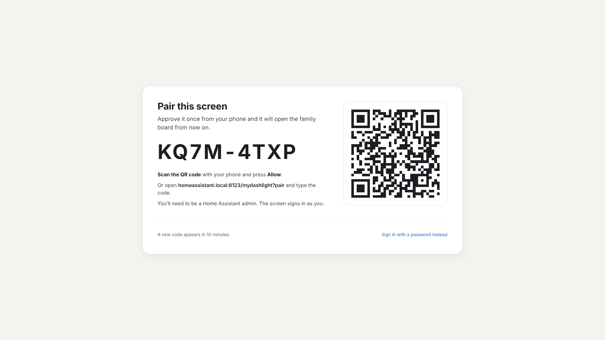

# Setting up MyDashLight

This guide goes from nothing to a working kitchen screen. Plan on about an hour, most of it in
Google Cloud the first time. You'll need:

- **Home Assistant** 2026.2 or later, reachable at an address that opens without a certificate
  warning from inside your home (for example `https://homeassistant.example.com:8123`). You need
  to be an admin.
- **A Google account** that can see and edit your family's calendar. MyDashLight signs in as this
  account, makes its chore lists in this account's Google Tasks, and saves drop-off reminders on its
  calendar.
- **The Home Assistant app** on each phone that should get ride reminders (optional).
- **A screen for the kitchen**: any browser works, or a Raspberry Pi set up with the script in
  [`kiosk/`](../kiosk/README.md) (optional).

## 1. Get the calendars ready

MyDashLight reads two Google calendars. In [Google Calendar](https://calendar.google.com):

1. **The family calendar.** Use the calendar your family already shares, or make one
   (**Settings > Add calendar > Create new calendar**) and share it with the other parent with
   **Make changes to events**. Every family event goes here, and each title starts with who it's
   for: "Ava Piano", "Ben & Cleo Dentist", "Robin Book club". Put the address in the location so
   drive times come out right. [The family calendar](calendar.md) has the details.
2. **A lunch calendar** (optional, for the Lunch tab). Make a new calendar, such as "MyDashLight
   Lunches". It doesn't need sharing; MyDashLight fills it in.

## 2. Set up Google sign-in

MyDashLight signs in with your own Google Cloud project, so your calendars only ever go between
Google and your Home Assistant. Calendar and Tasks cost nothing. Drive times use the Routes API,
which needs billing turned on; MyDashLight keeps its lookups to a daily limit you set.

1. In the [Google Cloud console](https://console.cloud.google.com/), make a project named
   **MyDashLight**.
2. Under [APIs & Services > Library](https://console.cloud.google.com/apis/library), turn on the
   **Google Calendar API** and the **Google Tasks API**. For drive times, also turn on the
   **Routes API** (this asks you to link a billing account).
3. Set up the [sign-in screen](https://console.cloud.google.com/auth/overview): app name
   MyDashLight, your email for support and contact, audience **External**. Then, under
   **Audience**, press **Publish app**. Without that, Google drops the sign-in after 7 days.
4. [Create an OAuth client](https://console.cloud.google.com/auth/clients) of type **Web
   application**, named MyDashLight. Under **Authorized redirect URIs** add both of these:
   - `https://my.home-assistant.io/redirect/oauth`, which Home Assistant uses whenever its My Home
     Assistant integration is loaded (it's part of the standard `default_config`).
   - `<your Home Assistant URL>/auth/external/callback`, which it uses otherwise.

   Keep the **client ID** and **client secret** for step 4. Don't put them anywhere else.
5. For drive times, [create an API key](https://console.cloud.google.com/apis/credentials)
   named "MyDashLight Routes" and, under **API restrictions**, limit it to the **Routes API**. A
   [budget alert](https://console.cloud.google.com/billing/budgets) of a few dollars a month is a
   good safety net.

Because the app isn't verified by Google, the sign-in in step 4 says "Google hasn't verified this
app". That's expected for an app only you use: press **Advanced**, then **Go to MyDashLight**.

## 3. Install MyDashLight in Home Assistant

MyDashLight installs as a custom repository from the Home Assistant Community Store, which newer
versions of Home Assistant include as the **Marketplace**. On older versions, install
[HACS](https://hacs.xyz/docs/use/) first.

1. Open the Marketplace (or HACS) from the sidebar. The first time, read and accept its warning.
2. From the **⋮** menu, choose **Custom repositories**. Add
   `https://github.com/mobrien118/MyDashLight` with the type **Integration**.
3. Find **MyDashLight**, press **Download**, and restart Home Assistant when it asks.

By hand instead: copy `custom_components/mydashlight` from this repository into the
`custom_components` folder of your Home Assistant config, then restart.

## 4. Add the integration

1. Go to **Settings > Devices & services > Add integration** and pick **MyDashLight**.
2. Paste the client ID and secret from step 2. Home Assistant saves them under **Application
   credentials**, so you only do this once.
3. Sign in to Google with the family account and allow the three permissions: see your calendar
   list, see and edit events (MyDashLight writes who drives into an event's notes), and see and edit
   your tasks (for chores).
4. **The parents who drive:** the names to show for each parent.
5. **Pick the calendars:** the family calendar, the lunch calendar, and the kids' names, in the
   order you want their columns.

MyDashLight makes its chore lists in Google Tasks the first time it runs, and a **Rides** item
appears in the sidebar.

## 5. Adjust the settings

Press **Configure** on the MyDashLight integration for these screens. Every one can be left alone
to start with.

| Screen | What's there |
| --- | --- |
| **Names and planner timing** | The parents' names and other names (Mom, Dad), each kid's nicknames, shortcuts that mean every kid, carpool drivers, the home address and how many days ahead chores are made. **Planner timing**, folded underneath, tunes how the planner judges a plan, such as when a kid counts as waiting and the drive time for an event with no address. |
| **Calendars** | The family and lunch calendars, and the kids. |
| **Chore points** | The default points for a chore, the share a late chore earns, and how long before someone else can earn it. See [Chores](chores.md). |
| **Lunch** | Which kids bring lunch by default, and each kid's school menu feed. See [Lunch](lunch.md). |
| **Drive times** | The Routes API key from step 2, and the daily limit on lookups (150 by default). See [Drive times](calendar.md#drive-times). |
| **Reminders** | Each person's phone, how long before leaving to remind them, and where each parent is for checking they're on their way. See [Reminders](reminders.md). |

For reminders, install the Home Assistant app on each phone and sign in. Each phone then shows up
as a notifier you can pick, and its location can be used for the parents.

## 6. Set up the kitchen screen

Open `<your Home Assistant URL>/mydashlight-kitchen` on the screen. It shows a code and a QR
code. Scan it with your phone, check the code matches, and press **Allow** (you need to be a Home
Assistant admin). The screen opens the board and stays signed in.



**On a Raspberry Pi:** [kiosk/README.md](../kiosk/README.md) turns a Pi 4 or 5 and any HDMI
screen into a kitchen screen that starts straight into the board, full screen. You write Raspberry
Pi OS Lite to a card, connect to the Pi with `ssh`, and run one command:

```sh
curl -fsSL https://raw.githubusercontent.com/mobrien118/MyDashLight/main/kiosk/setup.sh \
  | bash -s -- https://homeassistant.example.com:8123/mydashlight-kitchen
```

The script is [`kiosk/setup.sh`](../kiosk/setup.sh). It's safe to run again, for example to point
the screen at a new address.

Each screen can open on its own page and view, such as `?page=chores` or `?view=timeline`. See
[Screen settings](kitchen-app.md#screen-settings).

## Updating

The Marketplace checks this repository for a new version about every two days. To see one right
away, open MyDashLight there and choose **Update information** from its **⋮** menu. Then press
**Update** and restart Home Assistant. The kitchen screen picks up the new version by itself.

## If something's wrong

- **MyDashLight asks you to sign in to Google again** (under **Settings > Devices & services**):
  Google dropped the sign-in. Press **Reconfigure** and sign in with the same account. If it happens every week, the sign-in screen is still
  in testing; publish it (step 2.3).
- **The board says it can't read the calendars:** check the family calendar is still picked under
  **Configure > Calendars** and that the signed-in account can still see it.
- **An event doesn't show in anyone's column:** its title doesn't start with a name MyDashLight
  knows. It's listed under **Needs attention** as "Who is this for?"; tap it to pick.
- **The Marketplace shows an error while updating** but MyDashLight's version changed anyway: the
  update went through. Restart Home Assistant.
- **Anything else:** on the integration's page, **⋮ > Download diagnostics** saves what MyDashLight
  read and planned, without the sign-in or anyone's names, to attach to an
  [issue](https://github.com/mobrien118/MyDashLight/issues).
